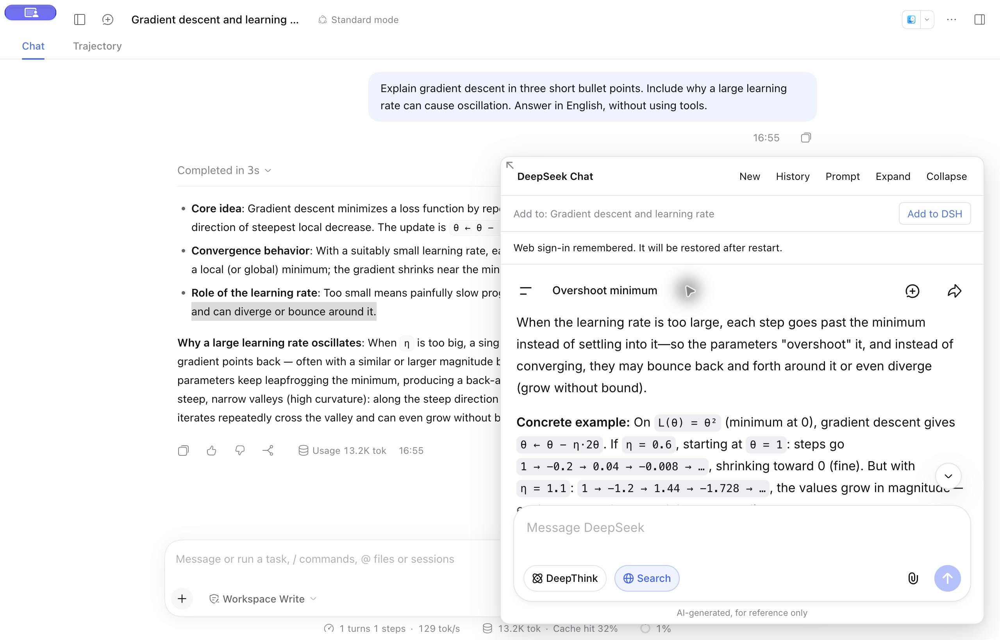
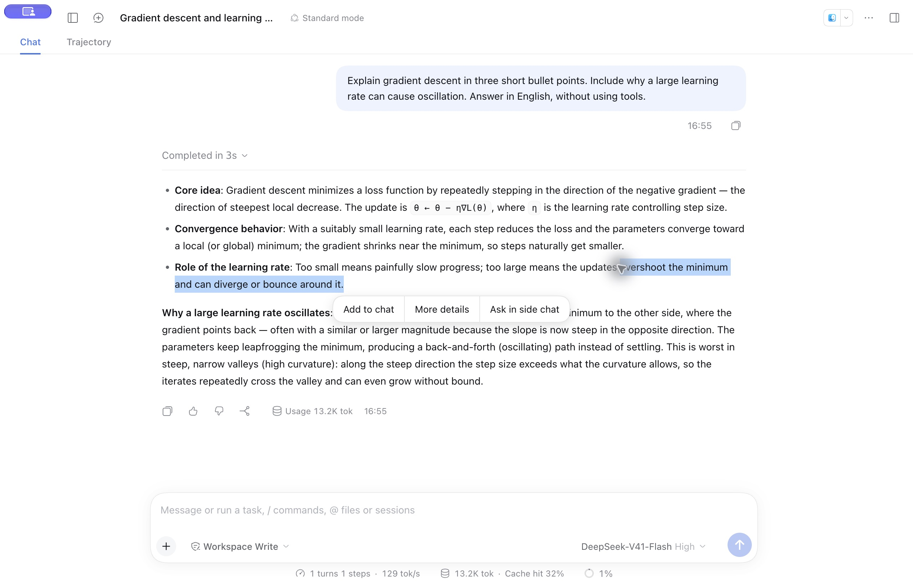
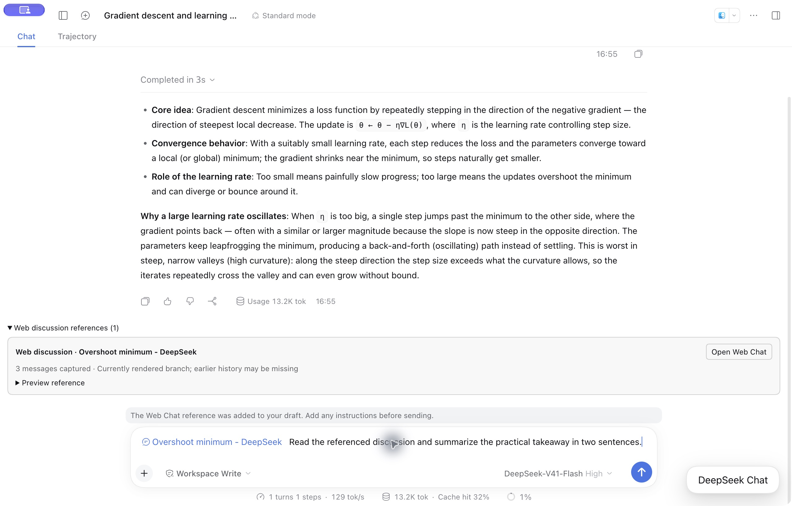

# 更多详情 · DSH Web Chat

[English](README.md) | 简体中文

**把旧版 Codex「更多详情」的交互体验带到 DeepSeek Harness。**

在主会话里划词，进入右下角 DeepSeek 网页小窗展开讨论，再通过引用卡回到主会话。支持新建聊天、历史重开和继续追问，让讨论不中断手头的工作。

[最新发布](https://github.com/RZRZ-Q/dsh-more-details/releases/latest) · [使用指南](docs/guide.zh.md) · [发布说明](docs/open-source/release-notes.md)

*macOS 上的 DSH 真实界面：在网页小窗里围绕选文展开讨论，同时保留主会话。*

查看操作流程：划词 → 网页讨论 → 引用回主会话

在回复中选中文字，点击 **More details（更多详情）**，选文和来源背景会自动发送到网页讨论。

点击 **Add to DSH（添加到 DSH）**，将引用卡放入主草稿；与问题一起发送后，主模型可按需读取已保存的讨论正文。

## 功能

- **围绕选文展开讨论**：「更多详情」将选文和来源背景自动发送到 DeepSeek 官网；在 **提示词** 中修改默认指令。
- **新建或接续聊天**：侧栏 **新建 Chat** 打开空白聊天，**继续聊天** 恢复收起的小窗且不重复发送，**历史** 可重开此前的讨论。
- **把讨论带回主会话**：**添加到 DSH** 将引用卡放入当前主草稿；支持预览、随问题发送，以及点击重开原网页聊天。
- **按需读取正文**：主模型通过 `read_webchat_reference` 读取已保存的讨论正文，重启后仍可使用。
- **保留使用习惯**：恢复有效网页登录态、官网语言和小窗尺寸。支持拖拽缩放、放大与收起；插件控件跟随 DSH 中英文设置。
- **其他划词操作**：**添加到聊天** 附上选文与批注；**在侧边对话中提问** 使用可自选的 DSH 模型进行临时讨论。

## 快速上手

支持版本：**DSH Desktop 0.2.0-rc.2、0.2.1-alpha.4、0.2.1-rc.1、0.2.1-rc.2 和 0.2.1-rc.3**。安装检查与历史桌面验收分开记录，逐版本范围见[验收记录](docs/open-source/validation.md)。Windows、Linux 尚未完成维护者功能验收。**网页讨论需要 Desktop。** 普通浏览器中的 DSH 会隐藏「新建 Chat」，将「更多详情」置灰并说明原因；添加到聊天、API 侧聊和已有引用的预览、读取仍可使用。

1. 在 **插件 → 添加插件** 中通过 npm 安装 **`dsh-more-details@0.3.17`**，也可使用[「发现」市场](docs/guide.zh.md#发现市场)。[Git 和 Release 安装包](docs/guide.zh.md#git-与-release-安装包)继续保留。若已安装原 AHGGG 插件，请停用它，避免重复划词菜单。
2. 完整退出并重开 DSH。点击 **新建 Chat**，在小窗内登录官网。网页登录与 DSH 模型账号配置分开。
3. 在已完成的消息中划词，点击 **更多详情**。可在 **提示词** 中保存自定义指令，内置默认值为「告诉我更多相关信息」。
4. 在小窗继续追问，用 **历史** 重开讨论，或用 **新建** 打开空白聊天。
5. 点击 **添加到 DSH**，核对目标会话，再将引用和问题一起发送。之后点击引用卡即可重开原聊天。

「发现」市场安装、Desktop CLI 和升级步骤见[安装指南](docs/guide.zh.md#安装与升级)。

## 数据如何使用

「更多详情」会把选文和来源背景发送到 DeepSeek。引用保存当时已渲染文字的快照，不是官网账号全部历史；主草稿由你决定何时发送，已保存快照不会随网页后续追问自动改变。[数据与隐私详情](docs/guide.zh.md#数据流与存储)。

## 文档

- [使用指南与常见问题](docs/guide.zh.md) · [构建与贡献](docs/guide.zh.md#开发与贡献)
- [兼容说明](docs/open-source/compatibility.md) · [验收记录](docs/open-source/validation.md) · [相关项目](docs/open-source/comparison.md)

## 致谢

交互灵感来自旧版 Codex 桌面端的 **更多详情** 与 Chat 小窗。代码基于 [AHGGG/dsh-side-chat](https://github.com/AHGGG/dsh-side-chat)，网页集成参考 [Ckarefulon/dsh-deepseek-webchat](https://github.com/Ckarefulon/dsh-deepseek-webchat) 和 [FrostLeafKEE/dsh-chat-bridge](https://github.com/FrostLeafKEE/dsh-chat-bridge)。

采用 [MIT 许可](LICENSE)，保留上游版权。详见[来源说明](UPSTREAM.md)与[第三方声明](THIRD_PARTY_NOTICES.md)。本项目为社区插件，与 DeepSeek、OpenAI 无官方隶属关系。
